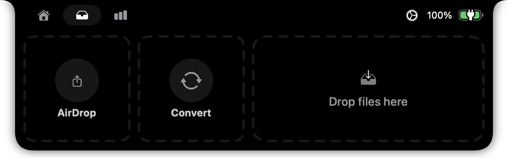

# Boring Notch, AI usage fork

A personal fork of [Boring Notch](https://github.com/TheBoredTeam/boring.notch) that adds an AI usage view and a file converter to the notch. Everything else in Boring Notch (music, calendar, the shelf with AirDrop, the HUD) works as before.

## What this fork adds

### AI usage

<p align="center">
  
</p>

A **Usage** tab with every account you use on Claude, Codex and Cursor in one list:

- Each account's weekly limit, how much is used and when it resets. Accounts that reset today or tomorrow come first (use them before the quota refreshes anyway); the rest are sorted by most room left.
- On each bar: a purple tick for the Fable limit, a white tick for even pace, and a yellow line while a 5-hour session limit is running.
- The 7-day pace across all accounts (how far ahead of even pace you are, and when you would run dry) and a burndown of the combined budget.
- Per-provider tabs with spend and token history.
- On a Mac with a notch, the closed notch shows each provider's weekly usage, and peeks down every 60 seconds.
- When [claude-swap](https://pypi.org/project/claude-swap/) switches account, the notch says which one.

**What it needs:**

- **[CodexBar](https://github.com/steipete/CodexBar): required.** The tab only reads CodexBar's data and never logs in to a provider itself. Install CodexBar and open it once. Without it the tab says so.
- **claude-swap: optional.** With it, each Claude account that CodexBar has usage for gets its own row. Without it, or if its files are missing, unreadable or don't match CodexBar's, Claude shows as one row from CodexBar's own login. A malformed file only loses that file's rows; the other providers keep working.

**What it reads** (local files, read-only, through the app's helper because the app is sandboxed):

| From | Files |
|---|---|
| CodexBar | `widget-snapshot.json` in its group container, `~/.codexbar/config.json`, `claude-swap-retained-usage.json` and `codex-account-snapshots.json` in `~/Library/Application Support/CodexBar/`, the `codexbar` CLI (for *Fetch live details*, and for spend history when the snapshot lacks it) |
| claude-swap | `~/.claude-swap-backup/sequence.json`: only each account's email, organisation name and which one is active |

Turn things on and off under **Settings → AI Usage**: *Show Usage tab*, *Fetch live details*, *Show usage in closed notch*, *Announce Claude account swaps*.

### File conversion

<p align="center">
  
</p>

Drop files on **Convert** on the shelf, or click it to pick them, then choose a format. Everything converts locally:

- **Images:** JPEG, PNG, HEIC, WebP, TIFF, GIF, BMP, PDF
- **PDFs:** pages to images, text, or merge several into one
- **Video:** MP4, HEVC, MOV, GIF, or extract the audio
- **Audio:** M4A, WAV, AIFF
- **Documents:** Word, RTF, HTML, text, ODT, PDF

Converted files go next to the originals or to Downloads (**Settings → Converter**).

## Install

Needs macOS 14 Sonoma or later and Xcode (last built with Xcode 27.2).

```bash
git clone https://github.com/AlexVialaBellander/boring-notch-ai.git
cd boring-notch-ai
xcodebuild -project boringNotch.xcodeproj -scheme boringNotch -configuration Debug \
  -derivedDataPath ~/Library/Developer/Xcode/DerivedData/boringNotch-ai \
  CODE_SIGN_IDENTITY=- CODE_SIGN_STYLE=Manual DEVELOPMENT_TEAM= build
open ~/Library/Developer/Xcode/DerivedData/boringNotch-ai/Build/Products/Debug/boringNotch.app
```

Quit any other copy of Boring Notch first. Keep the build out of `/tmp`: macOS clears it and the app then fails to launch.

## Checks

How the Usage tab handles missing or malformed CodexBar and claude-swap files:

```bash
swiftc -o /tmp/ai-usage-checks boringNotch/AIUsage/CodexBarModels.swift \
  BoringNotchXPCHelper/BoringNotchXPCHelper+CodexBar.swift Tests/AIUsageChecks/main.swift && /tmp/ai-usage-checks
```

## Credits and licence

Built on [Boring Notch](https://github.com/TheBoredTeam/boring.notch) by TheBoredTeam, through [boring.notch.claude](https://github.com/serrrfirat/boring.notch.claude). GPL-3.0, see [LICENSE](LICENSE); third-party licences in [THIRD_PARTY_LICENSES](THIRD_PARTY_LICENSES).
