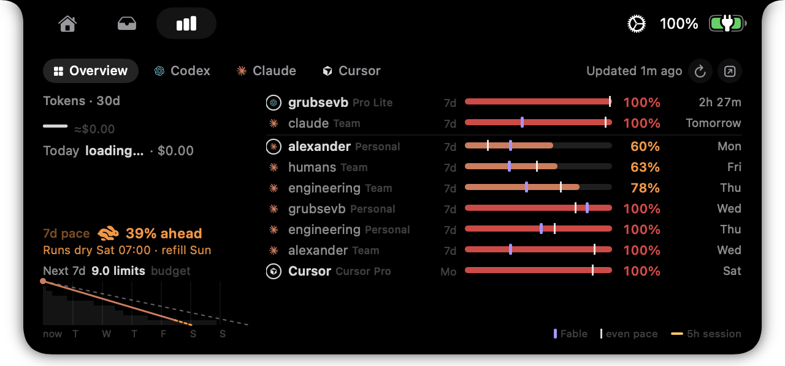

<h1 align="center">
  <br>
  <a href="http://theboring.name"></a>
  <br>
  Boring Notch
  <br>
</h1>


<p align="center">
  <a title="Crowdin" target="_blank" href="https://crowdin.com/project/boring-notch"></a>
  
  <a href="https://discord.gg/c8JXA7qrPm">
    
  </a>
  <a href="ttps://ko-fi.com/brandonhimpfen">
    
  </a>
</p>

<!--Welcome to **Boring.Notch**, the coolest way to make your MacBook's notch the star of the show! Forget about those boring status bars—our notch turns into a dynamic music control center, complete with a snazzy visualizer and all the music controls you need. It's like having a mini concert right at the top of your screen! -->

Say hello to **Boring Notch**, the coolest way to make your MacBook’s notch the star of the show! Say goodbye to boring status bars: with Boring Notch, your notch transforms into a dynamic music control center, complete with a vibrant visualizer and all the essential music controls you need. But that’s just the start! Boring Notch also offers calendar integration, a handy file shelf with AirDrop support, a complete MacOS HUD replacement and more!

<p align="center">
  
</p>

<!--https://github.com/user-attachments/assets/19b87973-4b3a-4853-b532-7e82d1d6b040-->
---
<!--## Table of Contents
- [Installation](#installation)
- [Usage](#usage)
- [Roadmap](#-roadmap)
- [Building from Source](#building-from-source)
- [Contributing](#-contributing)
- [Join our Discord Server](#join-our-discord-server)
- [Star History](#star-history)
- [Buy us a coffee!](#buy-us-a-coffee)
- [Acknowledgments](#-acknowledgments)-->

## What this fork adds

### AI usage

<p align="center">
  
</p>

A **Usage** tab with every account you use on Claude, Codex and Cursor in one list:

- Each account's weekly limit, how much is used and when it resets. Accounts that reset today or tomorrow come first (use them before the quota refreshes anyway); the rest are sorted by most room left.
- On each bar: a purple tick for the Fable limit, a white tick for even pace, and a yellow line while a 5-hour session limit is running.
- The 7-day pace across all accounts ("39% ahead, runs dry Sat 07:00") and a burndown of the combined budget.
- Per-provider tabs with spend and token history.
- On a Mac with a notch, the closed notch shows each provider's weekly usage, and peeks down every 60 seconds.
- When [claude-swap](https://pypi.org/project/claude-swap/) switches account, the notch says which one.

**What it needs:**

- **[CodexBar](https://github.com/steipete/CodexBar): required.** The tab only reads CodexBar's data and never logs in to a provider itself. Install CodexBar and open it once. Without it the tab says so.
- **claude-swap: optional.** With it, each Claude account gets its own row. Without it, or if its files are missing, unreadable or don't match CodexBar's, Claude shows as one row from CodexBar's own login. A malformed file only loses that file's rows; the other providers keep working.

**What it reads** (local files, read-only, through the app's helper because the app is sandboxed):

| From | Files |
|---|---|
| CodexBar | `widget-snapshot.json` in its group container, `~/.codexbar/config.json`, `~/Library/Application Support/CodexBar/*.json`, the `codexbar` CLI (for *Fetch live details*, and for spend history when the snapshot lacks it) |
| claude-swap | `~/.claude-swap-backup/sequence.json`: only each account's email, organisation name and which one is active |

Turn things on and off under **Settings → AI Usage**: *Show Usage tab*, *Fetch live details*, *Show usage in closed notch*, *Announce Claude account swaps*.

### File conversion

<p align="center">
  
</p>

Drop files on **Convert** on the shelf, or click it to pick them, then choose a format. Everything converts locally:

- **Images:** JPEG, PNG, HEIC, WebP, TIFF, GIF, BMP, PDF
- **PDFs:** pages to images, text, or merge several into one
- **Video:** MP4, HEVC, MOV, GIF, or extract the audio
- **Audio:** M4A, WAV, AIFF
- **Documents:** Word, RTF, HTML, text, ODT, PDF

Converted files go next to the originals or to Downloads (**Settings → Converter**).

### Building this fork

```bash
xcodebuild -project boringNotch.xcodeproj -scheme boringNotch -configuration Debug \
  -derivedDataPath ~/Library/Developer/Xcode/DerivedData/boringNotch-ai \
  CODE_SIGN_IDENTITY=- CODE_SIGN_STYLE=Manual DEVELOPMENT_TEAM= build
open ~/Library/Developer/Xcode/DerivedData/boringNotch-ai/Build/Products/Debug/boringNotch.app
```

Quit any other copy of Boring Notch first. Keep the build out of `/tmp`: macOS clears it and the app then fails to launch.

Checks for how the Usage tab handles missing or malformed CodexBar and claude-swap files:

```bash
swiftc -o /tmp/ai-usage-checks boringNotch/AIUsage/CodexBarModels.swift Tests/AIUsageChecks/main.swift && /tmp/ai-usage-checks
```

## Installation

**System Requirements:**  
- macOS **14 Sonoma** or later  
- Apple Silicon or Intel Mac

---
> [!IMPORTANT]
> We don't have an Apple Developer account yet. The application will show a popup on first launch that the app is from an unidentified developer.
> 1. Click **OK** to close the popup.
> 2. Open **System Settings** > **Privacy & Security**.
> 3. Scroll down and click **Open Anyway** next to the warning about the app.
> 4. Confirm your choice if prompted.
>
> You only need to do this once.


### Option 1: Download and Install Manually
<a href="https://github.com/TheBoredTeam/boring.notch/releases/latest/download/boringNotch.dmg" target="_self"></a>

---

### Option 2: Install via Homebrew

You can also install the app using [Homebrew](https://brew.sh):

```bash
brew install --cask TheBoredTeam/boring-notch/boring-notch --no-quarantine
```

## Usage

- Launch the app, and voilà—your notch is now the coolest part of your screen.
- Hover over the notch to see it expand and reveal all its secrets.
- Use the controls to manage your music like a rockstar.
- Click the star in your menu bar to customize your notch to your heart's content.

## 📋 Roadmap
- [x] Playback live activity 🎧
- [x] Calendar integration 📆
- [x] Reminders integration ☑️
- [x] Mirror 📷
- [x] Charging indicator and current percentage 🔋
- [x] Customizable gesture control 👆🏻
- [x] Shelf functionality with AirDrop 📚
- [x] Notch sizing customization, finetuning on different display sizes 🖥️
- [x] System HUD replacements (volume, brightness, backlight) 🎚️💡⌨️
- [ ] Bluetooth Live Activity (connect/disconnect for bluetooth devices) 
- [ ] Weather integration ⛅️
- [ ] Customizable Layout options 🛠️
- [ ] Lock Screen Widgets 🔒
- [ ] Extension system 🧩
- [ ] Notifications (under consideration) 🔔
<!-- - [ ] Clipboard history manager 📌 `Extension` -->
<!-- - [ ] Download indicator of different browsers (Safari, Chromium browsers, Firefox) 🌍 `Extension`-->
<!-- - [ ] Customizable function buttons 🎛️ -->
<!-- - [ ] App switcher 🪄 -->

<!-- ## 🧩 Extensions
> [!NOTE]
> We’re hard at work on some awesome extensions! Stay tuned, and we’ll keep you updated as soon as they’re released. -->

## Building from Source

### Prerequisites

- **macOS 14 or later**: If you’re not on the latest macOS, we might need to send a search party.
- **Xcode 16 or later**: This is where the magic happens, so make sure it’s up-to-date.

### Installation

1. **Clone the Repository**:
   ```bash
   git clone https://github.com/TheBoredTeam/boring.notch.git
   cd boring.notch
   ```

2. **Open the Project in Xcode**:
   ```bash
   open boringNotch.xcodeproj
   ```

3. **Build and Run**:
    - Click the "Run" button or press `Cmd + R`. Watch the magic unfold!

## 🤝 Contributing

We’re all about good vibes and awesome contributions! Read [CONTRIBUTING.md](CONTRIBUTING.md) to learn how you can join the fun!

## Join our Discord Server

<a href="https://discord.gg/GvYcYpAKTu" target="_blank"></a>

## Star History

<a href="https://www.star-history.com/#TheBoredTeam/boring.notch&Timeline">
 <picture>
   <source media="(prefers-color-scheme: dark)" srcset="https://api.star-history.com/svg?repos=TheBoredTeam/boring.notch&type=Timeline&theme=dark" />
   <source media="(prefers-color-scheme: light)" srcset="https://api.star-history.com/svg?repos=TheBoredTeam/boring.notch&type=Timeline" />
   
 </picture>
</a>

## Support us on Ko-fi!
<!-- <a href="https://www.buymeacoffee.com/jfxh67wvfxq" target="_blank"></a> -->
<a href="https://www.ko-fi.com/alexander5015" target="_blank"></a>

## 🎉 Acknowledgments

We would like to express our gratitude to the authors and maintainers of the open-source projects that made this possible. 

## Notable Projects
- **[MediaRemoteAdapter](https://github.com/ungive/mediaremote-adapter)** –  An open-source project that allowed us to use the Now Playing source in macOS 15.4+
- **[NotchDrop](https://github.com/Lakr233/NotchDrop)** – An open-source project that has been instrumental in developing the first version of the "Shelf" feature in Boring Notch.

For a full list of licenses and attributions, please see the [Third-Party Licenses](./THIRD_PARTY_LICENSES.md) file.

### Icon credits: [@maxtron95](https://github.com/maxtron95)
### Website credits: [@himanshhhhuv](https://github.com/himanshhhhuv)

- **SwiftUI**: For making us look like coding wizards.
- **You**: For being awesome and checking out **boring.notch**!


